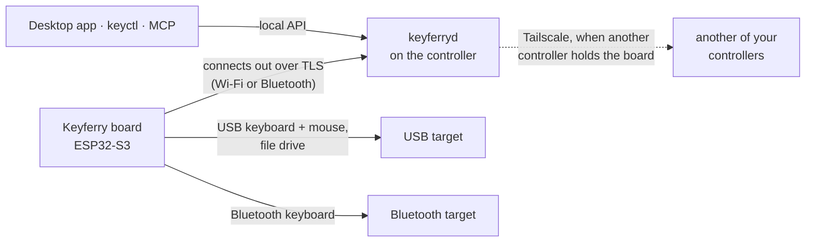
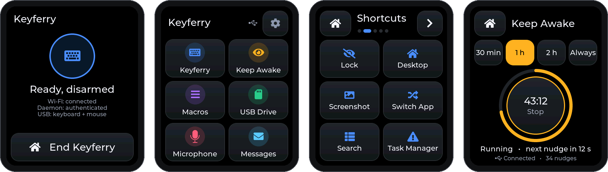

<div align="center">
  
  <h1>Keyferry</h1>
  <p><strong>A secure, portable network-to-USB keyboard bridge.</strong><br/>
  Type, run hotkeys and drive the mouse on another computer from a trusted one,
  with nothing installed on the computer you type into.</p>
  <p>
    <a href="#features">Features</a> ·
    <a href="#hardware">Hardware</a> ·
    <a href="#quick-start">Quick start</a> ·
    <a href="#command-line">Command line</a> ·
    <a href="#agent-control">Agent control</a> ·
    <a href="#safety-and-privacy">Safety</a> ·
    <a href="#building-from-source">Build</a>
  </p>
</div>

Keyferry is firmware for small ESP32-S3 boards plus a controller for Windows and macOS. The board
plugs into a computer (the *target*) as its USB keyboard and mouse, or pairs with it as a
Bluetooth keyboard. A trusted computer (the *controller*) sends it text, hotkeys and pointer input
over a mutually authenticated TLS link, carried over Wi-Fi or Bluetooth. If another of your
controllers holds the board, Keyferry routes through it over Tailscale.

> [!NOTE]
> Keyferry is a preview and is qualified board by board. [Hardware](#hardware) lists what has
> been tested on each board.

## Features

- **Typing.** Text of any length at a steady, configurable pace, with progress and cancel. Text
  the keyboard layout cannot type is rejected before sending, or replaced with `?` if you choose.
- **Hotkeys and sequences.** Keys are pressed in the order given and released in reverse
  (`Ctrl + L`, `CapsLock + Space + J`). Sequences combine text, taps, key combinations, waits and
  repeats; save reusable ones as local recipes.
- **Keyboard output over USB or Bluetooth.** USB mode is a keyboard and mouse; Bluetooth mode is a
  keyboard only.
- **Control over Wi-Fi or Bluetooth.** The board connects out to an authorized controller over
  known Wi-Fi or, in USB mode, a nearby Bluetooth control link.
- **Secure text.** A masked, owner-only dialog types a password into the target. The text never
  reaches an agent, logs, recipes or files.
- **Agent screen control.** With an HDMI capture dongle, an agent can see the target's screen and
  act on it through an MCP server: screenshots, OCR, calibrated pointer, keyboard and waits.
- **USB file handoff.** Publish one `MESSAGE.TXT`, or up to 16 named files sharing 256 KiB, on a
  read-only USB drive held only in the board's RAM.
- **Desktop app and command line** on Windows and macOS.

## How it works



- `keyferryd` runs on each controller and is the only component that can issue commands.
- The board has no web server, captive portal, inbound listener or access-point fallback. It opens
  one pinned, mutually authenticated TLS session to an authorized controller.
- Each controller holds its own credential, issued from the owner's encrypted *owner kit*, so one
  computer can be revoked without affecting the others.
- USB powers the board in both modes. Bluetooth keyboard mode is controlled over Wi-Fi only and has
  no USB keyboard or mouse. USB provisioning and file handoff still need the cable, and the
  USB-connected computer can differ from the Bluetooth target.

## Hardware

| Board | Form | Display | Status |
| --- | --- | --- | --- |
| Waveshare ESP32-S3-GEEK | USB stick | 240×135 LCD | Qualified on one unit: control, USB input, and 256 KiB file handoff to Windows |
| LILYGO T-Dongle-S3 | USB stick | 160×80 LCD | Control and USB input supported; file capacity unqualified |
| M5Stack AtomS3 Lite | USB stick | none (RGB LED) | Control, USB keyboard and pointer used with Windows targets; profile not yet qualified |
| Waveshare ESP32-S3-Touch-AMOLED-1.8 | Touch handheld | 368×448 AMOLED | Keyferry authenticated and typed over the Bluetooth control link on one unit; preview |

Bluetooth keyboard output has been tested on a Windows target. Mac typing and Mac/Linux USB drive
mounting are not yet physically qualified. Board differences live in one profile per board under
[`firmware/esp32s3/boards/`](firmware/esp32s3/boards/). The AMOLED board runs Keyferry inside a
small touchscreen shell with a few extra on-device functions; see
[Handheld deployment](#handheld-deployment).

## Quick start

These steps assume a provisioned board and an owner kit. Preparing a new board needs board-specific
recovery, backup, firmware installation and authorization, and is not yet a turnkey public flow;
see [`firmware/README.md`](firmware/README.md).

1. **Connect the board to USB power.** For USB keyboard/mouse input or file handoff, plug it into
   the computer that should receive them. Bluetooth keyboard output can use any USB power source.
2. **Install Keyferry on the controller.** Download the Windows x64 or macOS Apple silicon package
   from [Releases](https://github.com/smkwray/keyferry/releases), extract the whole package and run
   `install.ps1` or `install.sh` as its `README.txt` describes. Or [build from source](#building-from-source).
3. **Open Keyferry and choose Authorize this computer.** Pick the owner-kit file, enter the owner
   password and choose the board this computer will control. The computer receives its own
   credential for that board.
4. **Keep the control link reachable.** USB keyboard mode can use known Wi-Fi or the Bluetooth
   control link; on macOS, allow Bluetooth access when asked. Do not pair the control link in the
   operating system's Bluetooth settings. Bluetooth keyboard mode needs Wi-Fi control.

The installed service listens on every active private home or office network
(`--lan-interface auto`, never Tailscale or other point-to-point links); name an interface to
restrict it. It also picks up nearby boards over Bluetooth; `--bluetooth off` makes a controller
Wi-Fi/Tailscale-only, and macOS then never asks for Bluetooth permission.

These are preview builds: Windows executables are unsigned and the macOS app is not notarized, so
macOS may require [approval on first launch](https://support.apple.com/en-us/102445). The published
[September 27 preview](https://github.com/smkwray/keyferry/releases/tag/preview-2026-09-27) predates
several features described here, including secure text and screen power control. In that preview
the background service runs only while the app is open; current source installs a service that
starts at login, keeps running when the app closes, and is started by `keyctl` when needed.

## Desktop app

- **Send** shows the board's status, a text box and a hotkey field. Send when it shows **Ready**;
  **Stop** or Esc cancels active work. The text box and hotkey field clear after sending.
- **Devices** lists your boards. Select one to open **Connection / Wi-Fi**, **Keyboard & display**
  or **USB maintenance**; each page acts only on that board and shows its device ID. USB
  maintenance needs that board plugged into this computer and the owner-kit password.
- **Bluetooth keyboard.** Under **Keyboard & display**, choose **Bluetooth keyboard**; the board
  restarts and you pair it from the target's Bluetooth settings. **USB keyboard** switches back.
- **Screen on / Screen off** (on supported firmware) applies without a restart and persists across
  unplugging. To protect the panel, **Screen on** lights the display for 60 seconds after boot, a
  status change, a BOOT press or choosing **Screen on** again, then lets it sleep; the image drifts
  by a couple of pixels while lit.
- **USB files.** **Save as USB file** publishes `MESSAGE.TXT` on the board's read-only `KEYFERRY`
  drive. With multi-file firmware, **Choose USB files…** reviews names and sizes before publishing
  a set together, and **Refresh drive** shows what is published. Open the files on the computer
  connected by USB; publishing does not copy them anywhere or type them.

In USB keyboard mode, an unheld board advertises its Bluetooth *control* link; choose it under
**Devices** (there is no manual controller selection). Bluetooth keyboard pairing with the target
is separate. **Setup & security** prepares additional boards.

### Secure text

For passwords, use **Secure text…** on the Send page instead of the plain text box. An agent can
open the same dialog with `keyctl secure-text DEVICE_UUID [--wake none|mouse|mac-login]`; the
request itself sends no input. Run it in the logged-in desktop session where the human will type,
with the local controller running. With the target's password field focused, the human types into
the masked dialog and presses Enter (or **Send once**); Esc cancels.

- Accepts 1–256 printable ASCII characters and rejects anything else without replacement. Use the
  U.S./ABC input source with Caps Lock off. **Press Enter after the text** is on by default (change
  it under **Typing**).
- An optional, unsaved wake step runs first: **Mouse movement** (a tiny move out and back, no click;
  needs relative mouse support) or **Mac login screen (Shift)** (a Shift tap, then a two-second
  wait). A failed or uncertain wake sends no text.
- The prompt expires after two minutes, and results close after 30 seconds. `REQUESTED` means only
  that the prompt opened, not that typing or an unlock succeeded. Nothing is retried automatically.
- Never put the secret in chat, arguments or stdin, and never let an agent inspect the dialog.

The protections assume a trusted controller and operating system; temporary RAM copies and OS
paging or crash files are outside Keyferry's control. [SECURITY.md](SECURITY.md#agent-requested-secure-text)
details the limits. Software checks do not verify target focus, macOS unlock or preboot/FileVault input.

## Command line

`keyctl` talks to the local daemon and starts the installed service when needed. It is installed
next to the app:

- Windows: `%LOCALAPPDATA%\Programs\Keyferry\keyctl.exe`
- macOS: `~/Applications/Keyferry.app/Contents/MacOS/keyctl`

```text
keyctl devices                                  # list boards; use one whose link is "authenticated"
keyctl status DEVICE                            # one board's state, firmware and connection
keyctl capabilities                             # the controller's supported API features
keyctl stream DEVICE --input message.txt        # type a UTF-8 file of any length
keyctl sequence DEVICE < hotkey.json            # run a key sequence (JSON on stdin)
keyctl sequence --example                       # a valid starting sequence
keyctl keys                                     # key names and aliases (COMMAND, OPTION, ...)
keyctl cancel DEVICE                            # stop the running command
keyctl secure-text DEVICE                       # open the masked secure-text dialog
keyctl file DEVICE path/to/message.txt          # publish bytes as KEYFERRY/MESSAGE.TXT
keyctl files DEVICE a.txt b.txt                 # replace the drive with named files (v2 firmware)
keyctl file-status DEVICE                       # inspect the published file or list
keyctl file-clear DEVICE                        # clear the whole drive
keyctl screen-power DEVICE [on|off]             # read, or set, the board's screen
keyctl recipe list                              # saved sequences on this computer
keyctl recipe --example                         # a valid starting recipe
keyctl recipe import open-url.json              # validate and save a recipe (the only writer)
keyctl recipe inspect open-url                  # metadata, route and worst-case time
keyctl recipe run DEVICE open-url < params.json # run once; parameters as JSON on stdin
keyctl capture list                             # local HDMI/UVC video sources (no daemon)
keyctl capture frame --out screen.png           # capture one PNG to a new private path
keyctl input-sequence --describe                # supported pointer/keyboard actions and bounds
keyctl mcp                                      # stdio MCP server for agents
```

A hotkey pressed in order:

```json
{"schema":"keyferry.keyboard-sequence.v1","profile":"windows-us","arm":"command-scoped",
 "start_within_ms":5000,"actions":[{"type":"ordered_chord","keys":["CAPS_LOCK","SPACE","J"]}]}
```

`chord` presses its keys together in one report; `ordered_chord` presses them one after another.
Both end with every key released. Key names come from `keyctl keys`, with aliases such as
`COMMAND`/`CMD` for the GUI key and `OPTION`/`OPT` for Alt, plus `LEFT_`/`RIGHT_` forms.

<details>
<summary><strong>Notes for scripts and agents</strong></summary>

- `keyctl --help` works without credentials or a running app.
- Use an exact device ID from `devices`; never choose silently between several boards. `status`
  includes firmware capability flags and `link_path`/`via`, showing whether another computer holds
  the board.
- Check the exit status and JSON result. A missing response, `UNKNOWN`, or a lost connection after
  submission means the action may have happened: read status to reconcile it and never resend
  automatically. `EMITTED` means the board sent the keystrokes, not that the focused application
  received them.
- Sends use command-scoped arming; ordinary callers need no separate `arm`.
- `firmware.keyboard_lock_state` is `unsupported` on current firmware, so Keyferry cannot see Caps
  Lock. Make sure it is off before sending text.
- Recipes ([format](protocol/recipe-v1.md)) live in `KEYFERRY_RECIPE_DIR`, or `recipes` in the
  per-user Keyferry state directory. `recipe run` expands the recipe locally, reads parameter
  values only from stdin, posts one ordinary sequence and saves nothing.

</details>

### Device settings and recovery

| Control | Command | Effect |
| --- | --- | --- |
| Screen | `keyctl screen-power DEVICE [on\|off]` | Without a value, reads active and saved state. Changes live and persists. |
| Screen rotation | `keyctl display-orientation DEVICE [normal\|rotated-180]` | A change restarts the board. |
| Keyboard output | `keyctl output-mode DEVICE [usb-hid\|ble-hid]` | Where keystrokes go. A change restarts the board. |
| Forget keyboard pairing | `keyctl forget-bluetooth DEVICE` | Forgets the bonded Bluetooth target and restarts pairing. |
| Release held input | `keyctl disarm DEVICE` | Releases input and disarms. `cancel DEVICE` stops active work. |
| USB status | `keyctl local-status --owner-kit PATH --device UUID` | Over USB with the owner password; safety and network metadata, never Wi-Fi passwords. |
| Restart networking | `keyctl local-recover --owner-kit PATH --device UUID restart-network` | Over USB with the owner password; interrupts control and clears any published USB file. |

Screen, rotation, output-mode and pairing controls run on the computer holding the board's
authenticated connection. Screen power is the only setting forwarded over Tailscale; it needs
capable firmware and an idle, disarmed board, and after a lost response you read its state before
deciding what to do. For screen status, `stored` is the saved preference and `active` can lag while
the display applies it.

Local USB commands work without the daemon or network. Keep `--device UUID` explicit with a
multi-device owner kit, and give the owner password as one stdin line, never in arguments, shell
history, logs or an agent transcript. Other `local-recover` actions are `forget-bluetooth`,
`cancel-enrollment`, `usb-hid`, `ble-hid` and `reboot`. Output is JSONL: match the device, action
and operation IDs to the terminal result. Partial output is not success, and a nonzero exit alone
does not prove nothing happened.

### Owner administration

Wi-Fi policy and owner administration use the installed **`keyferry-pairing`** helper;
`keyferry-pairing --help` lists its arguments and stdin requirements.

| Task | Command |
| --- | --- |
| Save an edited Wi-Fi policy file | `save-roaming-policy --output PATH --replace` (policy JSON on stdin) |
| Apply that policy to one board | `update-roaming --owner-kit PATH --device UUID --policy PATH` |
| Recover the initial Wi-Fi policy | `recover-initial-roaming-policy --owner-kit PATH --device UUID --output PATH` |
| List owner-authorized boards | `list-owner-devices --owner-kit PATH` |
| Authorize a computer for one board | `issue-installation --owner-kit PATH --device UUID --output DIRECTORY` |
| Prepare another board | `add-owner-device`, `grant-device-to-installation`, `materialize-device-bootstrap` |
| Change the owner password | `change-owner-kit-passphrase --owner-kit PATH` (current/new/confirmation on stdin) |

Before a USB Wi-Fi policy operation, pause the board on its holding controller with
`keyctl maintenance DEVICE begin`, and run `keyctl maintenance DEVICE finish` afterwards, even when
the helper fails. Beginning maintenance interrupts the link and clears any published USB file. If
the app is closed, the helper works directly without a daemon. Policy files hold Wi-Fi secrets:
keep them private and never print them. Setup commands create credentials or bootstrap files; they
do not install or flash a board.

### Mac targets

The `windows-us` profile is the wire name of the US-ASCII key mapping, not a claim that the target
runs Windows. It types correctly on a Mac that treats the board as an ANSI keyboard with the U.S. or
ABC input source. If Keyboard Setup Assistant appears, choose ANSI or press the keys it asks for
yourself; Keyferry never types into it. If the Mac treats the board as ISO, `` ` `` and `~` come out
as `§` and `±`: change the type in System Settings › Keyboard › Change Keyboard Type. Keep Caps Lock
off; smart quotes, auto-capitalization and autocorrect can alter typed text in some apps.

## Agent control

`keyctl mcp` is a [stdio MCP server](https://modelcontextprotocol.io/specification/2025-11-25/basic/transports)
that lets an agent see a target through an HDMI capture dongle and act on it. Point your MCP client
at the installed `keyctl` with `["mcp"]` as arguments; it opens no network listener and needs no
device or source argument when there is exactly one of each. Install FFmpeg on controllers with
capture cards, and grant Camera permission on macOS.

| Tools | Purpose |
| --- | --- |
| `screenshot`, `find_text` | Capture the target screen (JPEG/PNG) and OCR it on the capture controller |
| `calibrate` | Bind the capture to the exact board from the observed cursor before pointer input |
| `move`, `click`, `drag`, `scroll` | Absolute pointer actions in screenshot pixels, with optional smooth `glide_ms` |
| `type_text`, `key` | Ordinary US-mapped text and key taps or chords |
| `wait_for_stable`, `wait_for_change` | Wait on the screen instead of sleeping |
| `status`, `list_devices`, `select_device`, `list_capture_sources`, `select_capture_source` | Inspect and choose the board and capture source |

Every action submits once with the daemon's normal authentication, arming and release guarantees,
and an `UNKNOWN` result is reconciled, never replayed. Secrets stay in the owner-only secure-text
dialog, never in MCP arguments. Keyferry stores no execution history, screens or OCR, but MCP
clients and model providers may retain tool arguments, results and images. Capture and OCR can run
on a different controller from the one holding the board, over the existing owner-mTLS tailnet API.

[`apps/keyctl/AGENT-CONTROL.md`](apps/keyctl/AGENT-CONTROL.md) is the full reference: selection
rules, calibration, the HTTP capture API, tool arguments, retention and the one-shot CLI loop.

## Safety and privacy

- The board starts disarmed. Sending authorizes and arms it for that command only; **Stop** or Esc
  cancels active work.
- Reboot, reconnect, cancellation and every fault path release all keys and discard pending work.
  A command that may have started is never retried.
- Knowing the Wi-Fi password grants no ability to type. Wi-Fi settings change only through an
  authenticated USB connection to the board, never remotely.
- Keyferry does not persist sent text, hotkeys, sequences or file contents; it holds them in memory
  while processing them. Command outcomes stay in memory for ten minutes so a client can ask how a
  send ended.
- A USB file stays in the board's RAM until cleared or until power or the controller session is
  lost. The USB-connected computer may keep its own copy.
- The board stores its configuration and pairing credentials, never payloads or keystrokes.
- On macOS the service writes a connection log (link events and errors, no content) to
  `~/Library/Application Support/keyferry/logs/`. The app's diagnostics view is off by default and
  held only in memory.
- Saved recipes are the exception: `keyctl recipe import` stores a recipe as written (owner-only on
  macOS) until you delete it. Runs and parameter values are never saved.
- Choosing a file with **Send a file…** may add its name to the operating system's recent files;
  pasting the path avoids that.

[SECURITY.md](SECURITY.md) has the full security contract and threat model.

## Handheld deployment

<p align="center">
  
  <br/>
  <sub>Keyferry, Home, Macros and Keep Awake, rendered from the firmware's own UI code by
  <code>scripts/preview_handheld.py</code>.</sub>
</p>

On the Waveshare ESP32-S3-Touch-AMOLED-1.8 (touchscreen, microSD slot, microphone, BOOT and PWR
buttons, USB-C), Keyferry runs inside a small touchscreen shell. **Keyferry** is the main function
and works as described above, with its status on screen; USB file handoff is not available on this
board. **End Keyferry**, or holding BOOT, leaves only after every key and button is confirmed
released.

The shell adds a few functions that use this board's hardware. They are separate from Keyferry:
each runs alone (choosing one from Home restarts the board into it with only its own USB device,
and leaving restarts to Home), and none has a path into Keyferry's command executor.

| Function | What it does |
| --- | --- |
| **Keep Awake** | A USB mouse that makes a tiny relative move out and back every 25 s, for 30 min, 1 h, 2 h or until stopped. It starts only when you tap Start and stops on sleep or unplug. |
| **Macros** | Thirty built-in presets on five pages: Media, Shortcuts, Edit, Present and Mouse. Shortcuts follow a Windows or Mac setting. One tap plays a preset once; presets hold no text or secrets. |
| **USB Drive** | Serves one disk image from the microSD card (`DRIVES/*.IMG`) as a USB drive, writable by default or read-only. What the computer saves stays on the card, so eject the drive there before unplugging; an image left without a clean eject is flagged. The board can also create FAT32 drives of 64 MB, 256 MB or 1 GB. |
| **Microphone** | The board's microphone as a standard USB microphone (48 kHz mono), with mute and adjustable sensitivity. Audio goes only to the computer, only while it records. |
| **Messages** | A USB serial port: programs on the computer show notices, alerts and Yes/No questions. Display-only; see [Messages](firmware/esp32s3/handheld/MESSAGES.md). |

**Settings** holds brightness, the screen-off delay (15 s to 5 min) and the Macros OS, plus a Board
Check screen. **PWR** blanks or wakes the screen (while the microphone is live it dims instead), and
the first touch on a dark screen only wakes it. **BOOT** returns to Home; in Keyferry, hold it.
[SECURITY.md](SECURITY.md#amoled-handheld-deployment) covers how these functions are kept apart
from Keyferry and what each one can reach.

## Building from source

Requires Rust (pinned in `rust-toolchain.toml`), Python 3.11 or newer, and a C++17 compiler for the
strict checks. Firmware builds also need ESP-IDF v6.0.3 and an explicit board profile; see
[`firmware/README.md`](firmware/README.md).

```text
cargo fetch --locked              # populate dependencies for the offline checks
python scripts/check.py --strict  # formatting, lints, tests, protocol vectors, repository checks
```

Release archives come from the native package gates, which also strip local paths from the
binaries:

```text
powershell -File scripts/check_windows_package.ps1    # Windows
sh scripts/check_macos_package.sh                     # macOS
python scripts/package_controller_release.py ...      # canonical, scanned release ZIP
```

Build runners read the CPU budget from `project.toml`. For a machine-specific override, create an
ignored `project.local.toml`, replacing `example-builder` with the local hostname:

```toml
[build.hosts.example-builder]
cpu_percent = 75
```

`python scripts/preview_handheld.py` renders every handheld screen on a computer from the device
build's LVGL configuration.

## Repository layout

```text
apps/keyferry/              desktop app (Slint)
apps/keyferryd/             controller daemon: command authority, TLS and Bluetooth links, local API
apps/keyctl/                command-line client and MCP server
crates/                     protocol, keyboard layouts, gateway credentials, simulator, local management
firmware/esp32s3/           board firmware and board profiles
firmware/esp32s3/handheld/  AMOLED handheld shell, functions and screen previews
protocol/                   protocol specification, key registry, golden vectors
tools/                      pairing/credential helper and firmware update tool
scripts/                    checks, installers, packaging
```

## License

MIT; see [`LICENSE`](LICENSE). Third-party components are listed in
[`THIRD_PARTY.md`](THIRD_PARTY.md).

The desktop app uses [Slint](https://slint.dev) under the Slint Royalty-free License 2.0.

<a href="https://slint.dev"></a>
