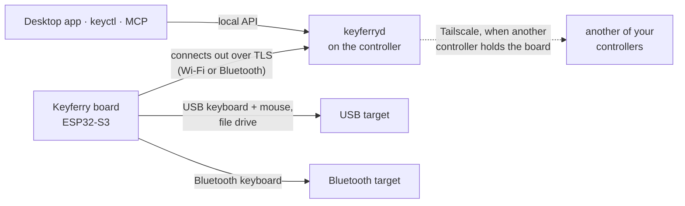

<div align="center">
  
  <h1>Keyferry</h1>
</div>

Keyferry turns a small ESP32-S3 board into a keyboard and mouse that another computer controls. The board plugs into the computer you want to type into (the *target*) as a USB keyboard and mouse, or pairs with it as a Bluetooth keyboard, so nothing is installed on the target. Your *controller*, a Windows or macOS computer running Keyferry, sends it text, hotkeys and pointer input over mutually authenticated TLS, carried by Wi-Fi or Bluetooth.

Keyferry is a preview, tested board by board. Controller packages for Windows x64 and Apple silicon Macs are unsigned and not notarized; there is no Linux controller. Preparing a new board is a manual, board-specific process (see [`firmware/README.md`](firmware/README.md)). The steps below assume a prepared board and its *owner kit*, the encrypted file that authorizes controllers.

## Hardware

| Board | Form | Display | Tested |
| --- | --- | --- | --- |
| Waveshare ESP32-S3-GEEK | USB stick | 240×135 LCD | One unit: control, USB input, 256 KiB file handoff to Windows |
| LILYGO T-Dongle-S3 | USB stick | 160×80 LCD | Control and USB input; file capacity untested |
| M5Stack AtomS3 Lite | USB stick | RGB LED only | Control, USB keyboard and pointer with Windows targets; full profile untested |
| Waveshare ESP32-S3-Touch-AMOLED-1.8 | Touch handheld | 368×448 AMOLED | One unit: typed over the Bluetooth control link, inside a [touchscreen shell](firmware/esp32s3/handheld/README.md) |

Bluetooth keyboard output is tested with a Windows target. Typing into a Mac, and mounting the USB drive on a Mac or Linux target, are not yet tested.

## What it does

- Types text of any length at a steady pace, with progress and cancel.
- Sends hotkeys and key sequences, which can be saved as recipes.
- Types passwords from *secure text*, a masked dialog that keeps them away from agents, logs and files.
- Hands up to 16 files (256 KiB in all) to the target on a read-only USB drive held in the board's RAM.
- Lets an agent see the target through an HDMI capture dongle and act on it, using an MCP (Model Context Protocol) server.

## How it works



- `keyferryd`, the controller's background service, is the only component that sends commands to a board.
- The board has no web server, inbound listener or access point. It connects out to an authorized controller over one pinned TLS session.
- Each controller has its own credential, so one can be revoked alone. Commands reach a board held by another of your controllers over Tailscale.

## Install

1. Plug the board into the target's USB port, or into any USB power source for Bluetooth keyboard output (USB file handoff still needs the target's port).
2. Download the Windows or macOS package from [Releases](https://github.com/smkwray/keyferry/releases), extract the whole archive and run `install.ps1` or `install.sh` as its `README.txt` describes, or [build from source](#building-from-source).
3. Open Keyferry, choose **Authorize this computer**, pick the owner-kit file, enter the owner password and choose the board.
4. Keep the control link reachable: known Wi-Fi, or in USB keyboard mode a Bluetooth control link. On macOS allow Bluetooth access when asked, and never pair the control link in the system's Bluetooth settings.

macOS may ask you to [approve the first launch](https://support.apple.com/en-us/102445). The published [September 27 preview](https://github.com/smkwray/keyferry/releases/tag/preview-2026-09-27) predates some features described here, such as secure text and screen power control.

Controllers listen for boards on private networks and reach each other over Tailscale on TCP ports 18043 and 18044 ([network settings](apps/keyctl/README.md#controller-network)). Authorize each computer separately; never copy an installation to another computer.

## Use

In the desktop app, the **Send** page types text or a hotkey once the board shows **Ready**, and **Devices** holds each board's settings; the [desktop app guide](apps/keyferry/README.md) covers both.

`keyctl` is installed next to the app, at `%LOCALAPPDATA%\Programs\Keyferry\keyctl.exe` on Windows and `~/Applications/Keyferry.app/Contents/MacOS/keyctl` on macOS:

```text
keyctl devices                            # boards; use one whose link is "authenticated"
keyctl status DEVICE                      # one board's state, firmware and connection
keyctl stream DEVICE --input message.txt  # type a UTF-8 file of any length
keyctl --help                             # every command
```

The [command-line reference](apps/keyctl/README.md) covers key sequences, [recipes](protocol/recipe-v1.md), scripting rules, device settings, USB recovery, owner administration and Mac targets.

## Agent control

`keyctl mcp` is a stdio MCP server that gives an agent screenshots, OCR, a calibrated pointer, keyboard input and screen waits, without opening a network listener. Point your MCP client at the installed `keyctl` with `["mcp"]` as its arguments. Capture needs FFmpeg (and Camera permission on macOS), and OCR works only on a Windows capture controller. MCP clients and model providers may keep tool arguments, results and images. See [`apps/keyctl/AGENT-CONTROL.md`](apps/keyctl/AGENT-CONTROL.md).

## Security and privacy

- The board is armed for one command at a time. Reboot, reconnect, cancellation and faults release all keys and drop pending work, and nothing that may have started is retried.
- The Wi-Fi password gives no ability to type, and Wi-Fi settings change only over an authenticated USB connection.
- Keyferry saves no sent text, keys or file contents; the board stores only its settings and credentials. Command outcomes stay in memory for ten minutes, and USB files stay in the board's RAM until cleared or until power or the controller session is lost. Saved recipes are kept until you delete them, and the macOS service logs connection events, without content, in `~/Library/Application Support/keyferry/logs/`.
- Secure text keeps a password from agents, logs and files, but trusts the controller and its operating system; see [its limits](apps/keyferry/README.md#secure-text).

## Building from source

Requires Rust (pinned in `rust-toolchain.toml`), Python 3.11 or newer, and a C++17 compiler for the strict checks. Firmware builds also need ESP-IDF v6.0.3; see [`firmware/README.md`](firmware/README.md).

```text
cargo fetch --locked              # populate dependencies for the offline checks
python scripts/check.py --strict  # formatting, lints, tests and protocol vectors
cargo build --release --locked    # keyferry, keyferryd, keyferry-pairing and keyctl in target/release
```

Install the built programs for the current user. Each installer prints its plan unless run with `Apply`:

```text
# Windows
powershell -File scripts/install_windows_controller.ps1 -Mode Apply `
  -ControllerExecutable target\release\keyferry.exe -DaemonExecutable target\release\keyferryd.exe `
  -PairingExecutable target\release\keyferry-pairing.exe -CliExecutable target\release\keyctl.exe

# macOS
sh scripts/package_macos_app.sh target/release/keyferry target/release/keyferryd \
  target/release/keyferry-pairing target/release/keyctl Keyferry.app
sh scripts/install_unix_controller.sh --controller Keyferry.app --mode Apply
```

## Repository layout

```text
apps/keyferry/              desktop app (Slint)
apps/keyferryd/             controller service: command authority, TLS and Bluetooth links, local API
apps/keyctl/                command-line client and MCP server
crates/                     protocol, keyboard layouts, gateway credentials, simulator, local management
firmware/esp32s3/           board firmware and board profiles
firmware/esp32s3/handheld/  AMOLED handheld shell
protocol/                   protocol specification, key registry, golden vectors
tools/                      pairing/credential helper and firmware update tool
scripts/                    checks, installers, packaging
```

## License

MIT; see [`LICENSE`](LICENSE). Third-party components are listed in [`THIRD_PARTY.md`](THIRD_PARTY.md).

The desktop app uses [Slint](https://slint.dev) under the Slint Royalty-free License 2.0.

<a href="https://slint.dev"></a>
