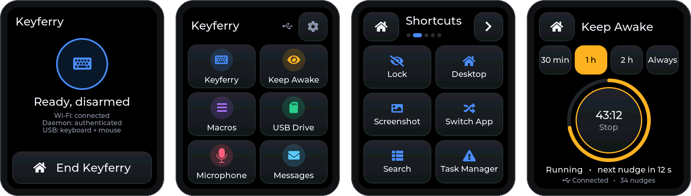

# Handheld

  
   
  Keyferry, Home, Macros and Keep Awake, rendered from the firmware's own UI code by <code>scripts/preview_handheld.py</code>.

On the Waveshare ESP32-S3-Touch-AMOLED-1.8 (touchscreen, microSD slot, microphone, BOOT and PWR buttons, USB-C), Keyferry runs inside a small touchscreen shell. **Keyferry** is the main function and works like the other boards, with its status on screen; USB file handoff is not available on this board. **End Keyferry**, or holding BOOT, leaves only after every key and button is confirmed released.

The shell adds a few functions that use this board's hardware. Each runs alone: choosing one from Home restarts the board into it with only its own USB device, and leaving restarts to Home. None of them can reach Keyferry's command handling.

| Function | What it does |
| --- | --- |
| Keep Awake | A USB mouse that makes a tiny relative move out and back every 25 seconds, for 30 minutes, 1 hour, 2 hours or until stopped. It starts only when you tap Start and stops on sleep or unplug. |
| Macros | Thirty built-in presets on five pages: Media, Shortcuts, Edit, Present and Mouse. Shortcuts follow a Windows or Mac setting. One tap plays a preset once; presets hold no text or secrets. |
| USB Drive | Serves one disk image from the microSD card (`DRIVES/*.IMG`) as a USB drive, writable by default or read-only. What the computer saves stays on the card, so eject the drive on the computer before unplugging; an image left without a clean eject is flagged. The board can also create FAT32 drives of 64 MB, 256 MB or 1 GB. |
| Microphone | The board's microphone as a standard USB microphone (48 kHz mono), with mute and adjustable sensitivity. Audio goes only to the computer, and only while it records. |
| Messages | A USB serial port on which programs on the computer show notices, alerts and Yes/No questions. Display-only; see [Messages](MESSAGES.md). |

**Settings** holds brightness, the screen-off delay (15 seconds to 5 minutes) and the Macros operating system, plus a Board Check screen. **PWR** blanks or wakes the screen (while the microphone is live it dims instead), and the first touch on a dark screen only wakes it. **BOOT** returns to Home; in Keyferry, hold it.

Only the Keyferry function uses Wi-Fi or Bluetooth or accepts commands from a controller. Keep Awake and Macros send input to the USB-connected computer from touches on the board alone, with no controller. The microSD card is not encrypted, so anyone holding it can read the drive images. Messages is unauthenticated, so any program on the USB-connected computer can show text there, including misleading prompts.

`python scripts/preview_handheld.py` renders every handheld screen on a computer from the device build's LVGL configuration; it needs a device build first.
